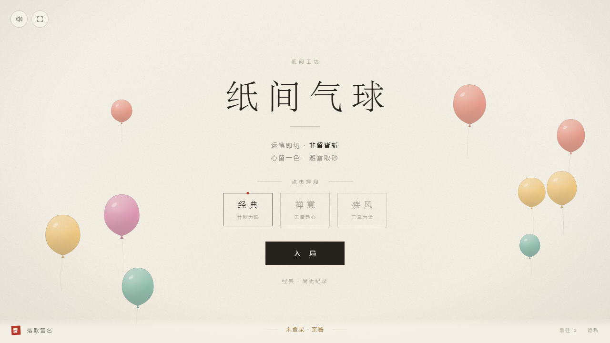
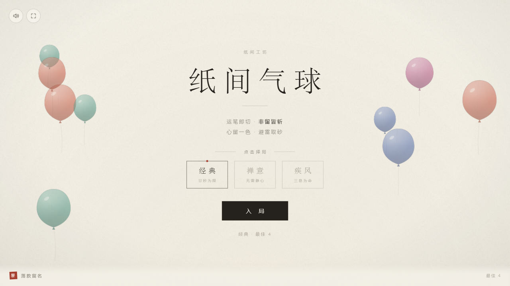
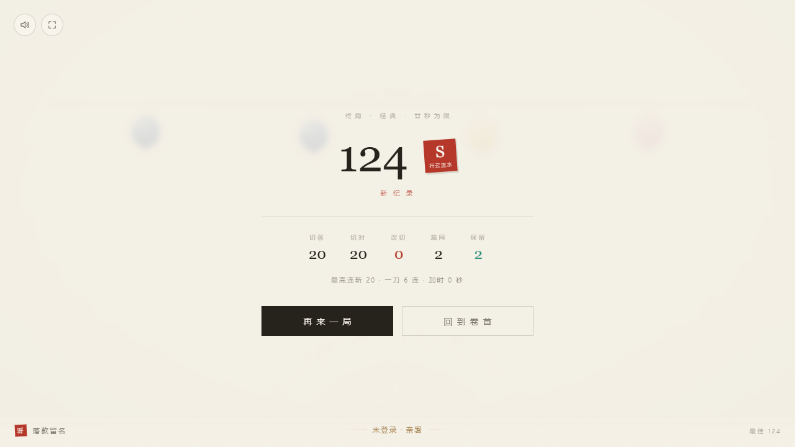

<div align="center">

# 纸间气球 · Paper Balloon

**一款水墨纸艺风格的切气球小游戏 —— 运笔即切，一刀两断**
[](https://apps.microsoft.com/detail/9P7KV11KM2M1)
[](https://balloon.weidenglu.com)
[](LICENSE)
[](https://github.com/PCWJ08/balloon)
[](https://github.com/PCWJ08/balloon)
[](https://github.com/PCWJ08/balloon)

*A minimalist Fruit-Slash game in Chinese ink-and-paper style. One HTML file, zero dependencies.*

[在线试玩](https://balloon.weidenglu.com) · [微软商店](https://apps.microsoft.com/detail/9P7KV11KM2M1) · [隐私声明](https://balloon.weidenglu.com/privacy.html) · [报告问题](https://github.com/PCWJ08/balloon/issues)



</div>

---

## 简介

「纸间气球」是一页会玩的宣纸：五色纸鸢自纸上浮起，运笔即切，**切落非留之色**，留一色于心。避开墨雷、追逐时砂、偶得墨涟缓时——在连斩与心流之间，练一手又轻又准的刀。

整个游戏只有一个 `index.html`：没有框架、没有构建、没有外部资源，图片在启动时以代码「烘焙」，音效用 WebAudio 现场合成。双击即玩，离线可玩。

| 卷首 | 对局 | 终局 |
| --- | --- | --- |
|  |  |  |

## 三种玩法

| 玩法 | 规则 | 适合 |
| --- | --- | --- |
| **经典** | 廿秒为限，切落非保留之色得分，时尽收场 | 日常手感 |
| **禅意** | 六十息、无墨雷、误切不断分只断连斩 | 静心连斩 |
| **疾风** | 三息为命：漏网、误切、墨雷各损一息；长风不断、气球渐快 | 挑战生存 |

## 计分与规则

- **连斩倍率**：连续切中非保留色，5 / 10 / 15 连时倍率升为 ×2 / ×3 / ×4；心流期间再翻倍
- **一刀多切**：一笔划过 N 只气球，额外 +2×(N−1)
- **保留色**：标「留」字的气球不可切，误切 −1 分并断连斩
- **墨雷**：切中 −3 分，震屏顿帧
- **时砂**：金钟气球，+2 秒（疾风模式改为补一息）
- **墨涟**：墨色水纹气球，切中进入 3 秒慢镜，涟中万象皆缓

## 操作

| 操作 | 方式 |
| --- | --- |
| 切 | 鼠标滑动 / 触屏划动（无需按住） |
| 暂停 | `Esc` 或右上角暂停钮；切走标签页自动暂停 |
| 全屏 | 左上角全屏按钮（不支持全屏的环境自动隐藏） |
| 声音 | 左上角喇叭，静音状态会被记住 |
| 榜单 | 右下角「榜」，开局、暂停、终局可见；对局中收起，不挡划动 |

手机上无需按住：手指划过即切。微信里打开同样可玩，转发到聊天时卡片会带标题、摘要与缩略图。

## 技术实现

- **Canvas 2D** 渲染：气球、切割两半、纸屑、墨环、风痕全部程序化绘制；精灵图在启动时用代码烘焙，无任何图片资源
- **WebAudio** 合成音效：切纸、木鱼、钟鸣、风声环境音均为振荡器与噪声实时合成，无音频文件
- **单文件 · 零依赖**：游戏全部逻辑、样式、资源在一个 HTML 内（约 100KB），双击即玩、离线可玩
- **细节**：devicePixelRatio 适配、`prefers-reduced-motion` 降级、页面隐藏自动暂停、窗口失焦保护、逐帧冻结与震屏反馈

## 安装为桌面应用

**方式一 · 微软商店（推荐）**：在 Microsoft Store 搜索「纸间气球」，或直接访问[商店页面](https://apps.microsoft.com/detail/9P7KV11KM2M1)——安装即离线可玩，自动更新。

**方式二 · 浏览器 PWA**：用 Edge/Chrome 访问[线上地址](https://balloon.weidenglu.com)，地址栏点「安装」——开始菜单出现独立窗口的「纸间气球」，同样支持离线游玩。

## 本地运行

游戏本体是纯静态页，双击 `public/index.html` 即可试玩（此时排行榜不可用）。

要连排行榜一起跑，装一次依赖再起本地 Worker：

```bash
npm install
npm run dev        # http://127.0.0.1:8787
```

`wrangler dev` 会同时提供静态页与 `/api/board`，Durable Object 在本地以 SQLite 模拟，数据存在 `.wrangler/` 里。

## 部署（Cloudflare Workers）

仓库自带 `wrangler.jsonc`，推送到 GitHub 后由 Cloudflare 自动构建部署，不需要手动上传文件。

| 设置 | 值 |
| --- | --- |
| 构建命令 | 留空 |
| 部署命令 | `npx wrangler deploy` |
| 自定义域 | `balloon.weidenglu.com` |

结构上是「一个 Worker + 一份静态资源」：

- `public/` 由 Workers 静态资源托管，`run_worker_first` 让 `/api/*` 优先落到 Worker
- `/api/board` 转给 Durable Object `Board`，全站只有一个实例，所有设备共用同一份榜单
- 数据存在 Durable Object 的 SQLite 里，表在首次唤醒时自建，**不需要建库、不需要跑迁移**
- 读榜带 30 秒边缘缓存，交成绩不缓存；接口开了 CORS，商店版（`ms-appx-web://`）也能直接调
- 同一设备 1.5 秒内只收一次成绩，单 IP 每分钟上限 120 次，都只是防误触与脚本空转

部署完验两条：

```bash
curl -s "https://balloon.weidenglu.com/api/board?tab=high" | head -c 200
curl -s -X POST https://balloon.weidenglu.com/api/board \
     -H 'Content-Type: application/json' \
     -d '{"dev":"test-device-0001","score":42,"mode":"classic"}'
```

第一条返回 `{"ok":true,...}`，第二条返回 `{"ok":true,"hi":42,...}`，即通。

## 目录结构

```
.
├── public/                 # 对外托管的静态资源
│   ├── index.html          # 游戏本体（全部逻辑、样式、资源）
│   ├── manifest.json       # PWA 清单（名称/图标/截图/主题色）
│   ├── sw.js               # Service Worker（离线缓存；/api/ 直连不缓存）
│   ├── privacy.html        # 隐私声明
│   ├── share.jpg           # 转发缩略图（400×400，兼作 og:image）
│   ├── icons/              # PWA 图标（192 / 512 / maskable）
│   └── screenshots/        # 展示图（兼作 PWA 安装预览图）
├── src/
│   ├── index.js            # Worker 入口：/api/board 转 Durable Object，其余交给静态资源
│   └── board.js            # 排行榜：读写、排名、地区换算、限流
├── wrangler.jsonc          # Workers 配置（静态目录、DO 绑定、迁移）
├── package.json            # 只依赖 wrangler
├── LICENSE                 # MIT
└── README.md
```

## 开源许可

[MIT](LICENSE) © 2026

<div align="center">
<sub><b>未登录 · 亲署</b></sub>
</div>
