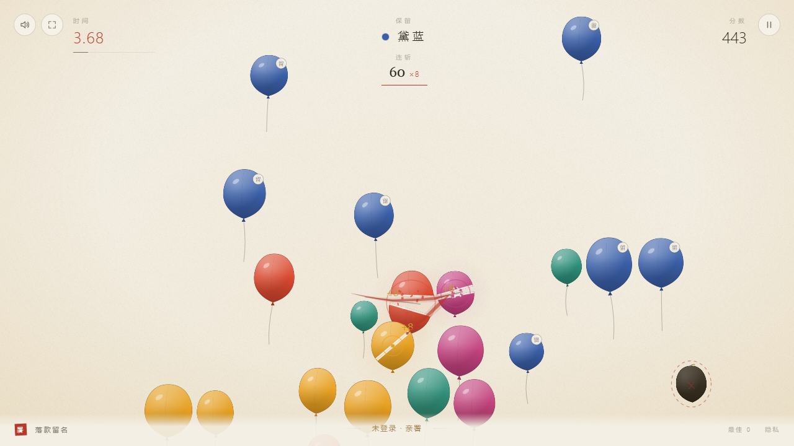
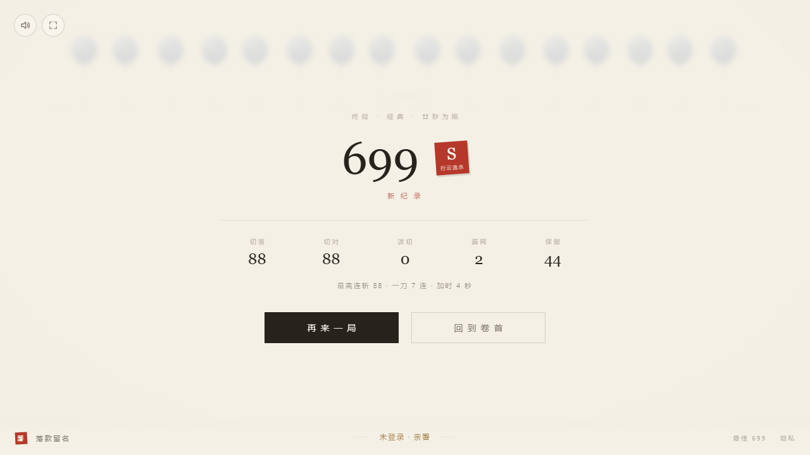

# 纸间气球 · Paper Balloon

**一款水墨纸艺风格的切气球小游戏 —— 运笔即切，一刀两断**

*A minimalist Fruit-Slash game in Chinese ink-and-paper style. One HTML file, zero dependencies.*

[在线试玩](https://balloon.weidenglu.com) · [微软商店](https://apps.microsoft.com/detail/9P7KV11KM2M1) · [隐私声明](https://balloon.weidenglu.com/privacy.html) · [报告问题](https://github.com/PCWJ08/balloon/issues)

---

## 简介

「纸间气球」是一页会玩的宣纸：五色纸鸢自纸上浮起，运笔即切，**切落非留之色**，留一色于心。避开墨雷、追逐时砂、偶得墨涟缓时——在连斩与心流之间，练一手又轻又准的刀。

游戏本体只有一个 `index.html`：没有框架、没有构建、没有图片与音频资源——图案在启动时以代码「烘焙」，音效用 WebAudio 现场合成。双击即玩，断网照玩。

在线版另附一个极小的全球排行榜，只用来记成绩；不联网，单机依然完整。

| 卷首 | 对局 | 终局 |
| --- | --- | --- |
|  |  |  |

## 三种玩法

| 玩法 | 规则 | 适合 |
| --- | --- | --- |
| **经典** | 廿秒为限，切落非保留之色得分，时尽收场 | 日常手感 |
| **禅意** | 六十息、无墨雷、误切不扣分只断连斩 | 静心连斩 |
| **疾风** | 三息为命：漏网、误切、墨雷各损一息；长风不断、气球渐快 | 挑战生存 |

## 计分与规则

- **连斩倍率**：连续切中非保留色，5 / 10 / 15 连时倍率升为 ×2 / ×3 / ×4；心流期间再翻倍
- **一刀多切**：一笔划过 N 只气球，额外 +2×(N−1)
- **保留色**：标「留」字的气球不可切，误切 −1 分并断连斩
- **墨雷**：切中 −3 分，震屏顿帧
- **时砂**：金钟气球，+2 秒（疾风模式改为补一息）
- **墨涟**：墨色水纹气球，切中进入 3 秒慢镜，涟中万象皆缓

分数可以是负的——低分榜正是为此而设。

## 排行榜

打完一局自动记下，不需要注册，也不显示姓名，只看地区与分数。

| | 收什么 | 怎么排 |
| --- | --- | --- |
| **高分榜** | 只收正分 | 由高到低，前一百 |
| **低分榜** | 只收负分 | 由低到高，前一百 |

- 一台设备只占一行：更高的分覆盖旧分，不会因为多打几局就占满榜面
- 0 分不入榜；没打完一局也不算
- 榜单开着时每三十秒自行更新一次
- 断网时不上报，游戏照玩

## 操作

| 操作 | 方式 |
| --- | --- |
| 切 | 鼠标滑动 / 触屏划动（无需按住） |
| 暂停 | `Esc` 或右上角暂停钮；切走标签页自动暂停 |
| 全屏 | 左上角全屏按钮（不支持全屏的环境自动隐藏） |
| 声音 | 左上角喇叭，静音状态会被记住 |
| 榜单 | 右下角「榜」，开局、暂停、终局可见；对局中收起，不挡划动 |
| 语言 | 左上角「中 / EN」，一键切换全界面中英文，选择会被记住 |

手机上无需按住：手指划过即切。微信里打开同样可玩。

界面支持中英双语：首次按系统语言自动选择，之后跟随左上角开关，记在本机。

## 技术实现

- **Canvas 2D** 渲染：气球、切割两半、纸屑、墨环、风痕全部程序化绘制；精灵图在启动时用代码烘焙，无任何图片资源
- **WebAudio** 合成音效：切纸、木鱼、钟鸣、风声环境音均为振荡器与噪声实时合成，无音频文件
- **单文件 · 零依赖**：游戏本体约 100KB，逻辑、样式、资源都在一个 HTML 内，双击即玩
- **手感细节**：连斩判定窗口、逐帧冻结、震屏、心流倍率与慢镜共用一套时间基准，保证不同帧率下手感一致
- **适配**：devicePixelRatio 上限 2、`prefers-reduced-motion` 降级、页面隐藏自动暂停、窗口失焦保护
- **排行榜**：一台设备一行，读写各一次往返；榜面停留时定时刷新，滚动位置保持不跳

## 安装为桌面应用

**方式一 · 微软商店（推荐）**：在 Microsoft Store 搜索「纸间气球」，或直接访问[商店页面](https://apps.microsoft.com/detail/9P7KV11KM2M1)——安装即离线可玩，自动更新。

**方式二 · 浏览器 PWA**：用 Edge/Chrome 访问[线上地址](https://balloon.weidenglu.com)，地址栏点「安装」——开始菜单出现独立窗口的「纸间气球」，同样支持离线游玩。

## 隐私

游戏不上传署名与最高分，它们只留在本机。排行榜只收到三样：本局分数、玩法、一个随机设备号；地区由连接网络粗略换算到省级，仅用于展示。详见[隐私声明](https://balloon.weidenglu.com/privacy.html)。

## 开源许可

[MIT](LICENSE) © 2026

<b>未登录 · 亲署</b>

